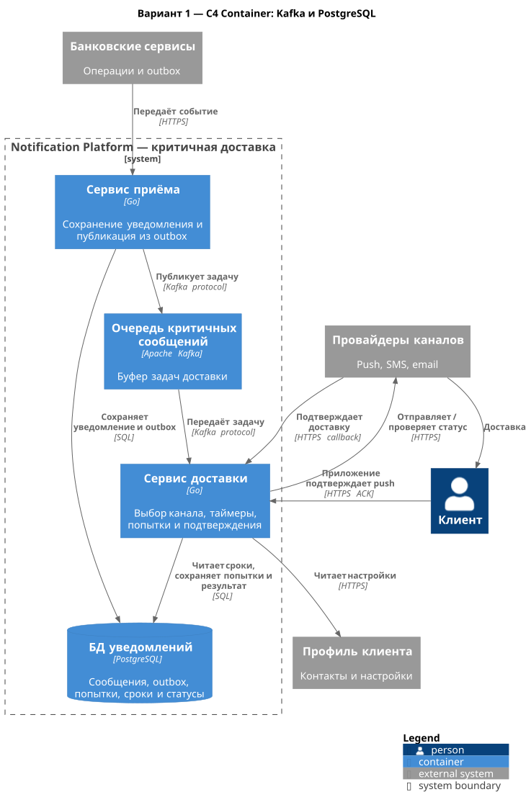
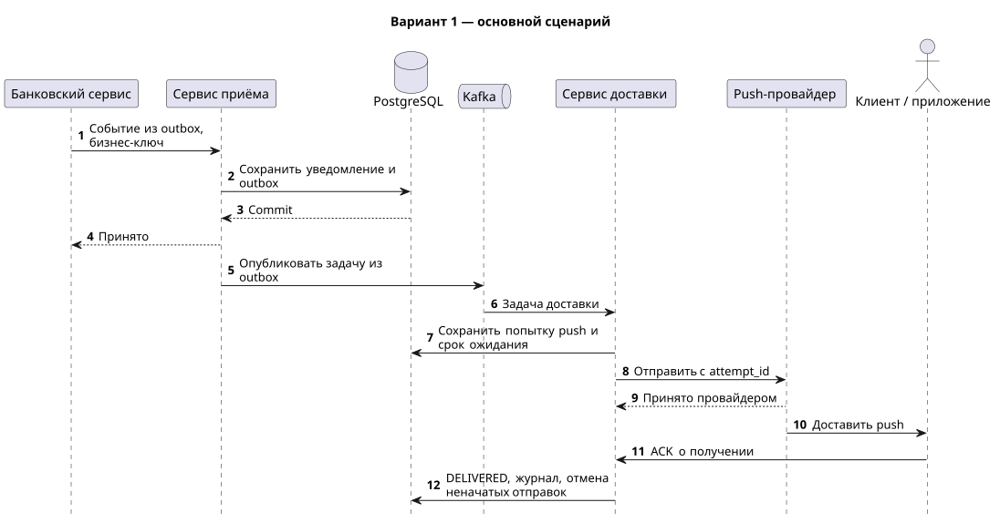
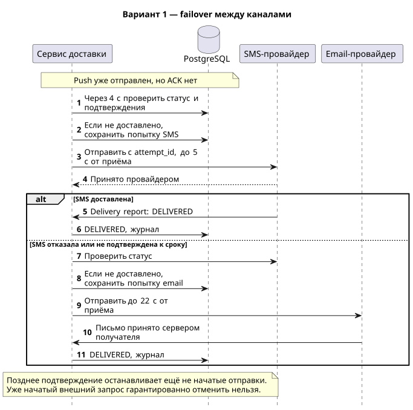
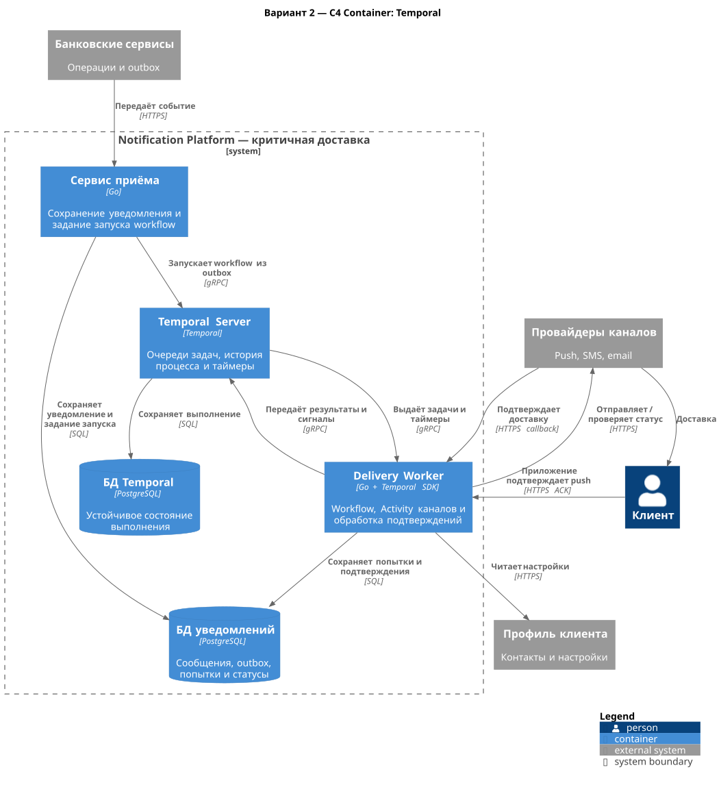
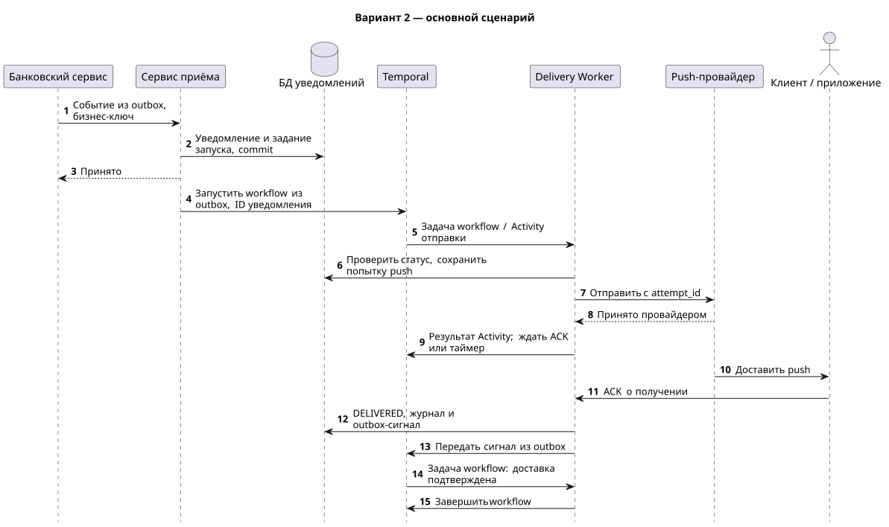
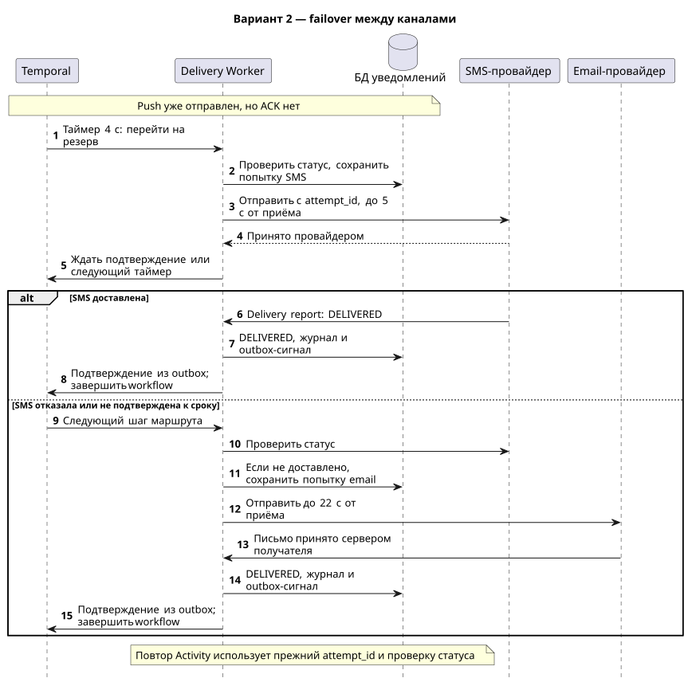

# RFC: Гарантированная доставка критичных уведомлений с автоматическим failover между каналами

| Метаданные | Значение |
| --- | --- |
| **Статус** | DESIGN |
| **Автор(ы)** | Леонид Кубинский |
| **Ответственный** | Технический лидер Notification Platform |
| **Бизнес-заказчик** | Владелец клиентских коммуникаций банка |
| **Ревьюеры** | Не назначены |
| **Дата создания** | 2026-11-16 |
| **Дата обновления** | 2026-11-16 |

## Оглавление

1. [Контекст](#контекст)
2. [Продуктовый анализ](#продуктовый-анализ)
3. [Пользовательские сценарии](#пользовательские-сценарии)
4. [Статистика](#статистика)
5. [Требования](#требования)
6. [Варианты решения](#варианты-решения)
7. [Сравнительный анализ](#сравнительный-анализ)
8. [Выводы](#выводы)
9. [Связанные задачи](#связанные-задачи)
10. [Приложения](#приложения)

## Контекст

Сейчас команды онлайн-банка отправляют уведомления самостоятельно. Это приводит к задержкам, дублям и отсутствию единого контроля доставки.

Notification Platform должна объединить транзакционные, сервисные и маркетинговые сообщения по push, SMS и email. Требования ниже относятся ко всей платформе, а варианты архитектуры подробно рассматривают доставку критичных сообщений: подтверждений переводов и списаний.

Подсистема должна сохранять принятое уведомление, автоматически переключать каналы при сбоях, учитывать настройки клиента, уменьшать расходы на SMS и показывать результат доставки.

## Продуктовый анализ

| Бизнес-цель | Как платформа помогает | Как оценить результат |
| --- | --- | --- |
| Увеличить retention на 15% | Своевременные сообщения и выбор удобного канала | Относительный рост D30 retention; например, с 40% до 46% |
| Снизить жалобы на 30% | Управление категориями, устранение логических дублей и контроль статусов | Относительное снижение обращений об уведомлениях на 100 тыс. уведомлённых пользователей |
| Обеспечить критичную доставку | Сохранение сообщений, повторы и резервные каналы | Доля критичных сообщений, подтверждённых за 60 секунд |

Пользователь может отключать маркетинг и сервисные напоминания. Уведомления о переводах и списаниях отключить целиком нельзя, но можно выбрать предпочтительный канал. Если этот канал недоступен, банк использует резервный. Цели retention и жалоб проверяются после внедрения сравнением сопоставимых групп пользователей.

## Пользовательские сценарии

| Приоритет | Тип сценария | Действующее лицо | Сценарий |
| --- | --- | --- | --- |
| MUST HAVE | Основной | Клиент | После перевода получает уведомление через предпочтительный доступный канал |
| MUST HAVE | Failover | Клиент | Если push не подтверждён, получает SMS; если SMS также не подтверждена — email |
| MUST HAVE | Настройки | Клиент | Отключает акции и напоминания, продолжая получать сообщения о деньгах |
| MUST HAVE | Повтор запроса | Продуктовая команда | Повторяет запрос после сбоя, не создавая второе логическое уведомление |
| MUST HAVE | Контроль | Поддержка | Видит статус, историю попыток и причину перехода на другой канал |
| SHOULD HAVE | Кампания | Маркетолог | Отправляет кампанию до 1 млн получателей без задержки критичных сообщений |

MUST HAVE — обязательно; SHOULD HAVE — желательно.

## Статистика

Исходные данные: **MAU — 10 млн, DAU — 3 млн, одновременно активных пользователей в пике — 300 тыс.** На пользователя приходится 2 транзакционных, 3 сервисных и 5 маркетинговых уведомлений в день.

Для основного расчёта применяем дневную частоту к DAU. Пиковый коэффициент 10 — проектное допущение.

### Расчёт нагрузок

| Тип | Уведомлений в день | В среднем в секунду | Пик ×10 |
| --- | ---: | ---: | ---: |
| Транзакционные | 3 млн × 2 = 6 млн | 69 | 694 ≈ 700 |
| Сервисные | 3 млн × 3 = 9 млн | 104 | 1 042 |
| Маркетинговые | 3 млн × 5 = 15 млн | 174 | 1 736 |
| **Всего** | **30 млн** | **347** | **3 472** |

Рассылка 1 млн сообщений за 10 минут добавляет около **1 667 сообщений/с**. Консервативно считаем её дополнительной к обычному пику: `3 472 + 1 667 ≈ 5 139/с`. Поэтому проектируем приём на **6 000 сообщений/с**, выделяя критичному тракту мощность минимум **1 000/с**.

300 тыс. одновременных пользователей не равны 300 тыс. уведомлений в секунду: скорость зависит от их действий. Если дневная частота относится ко всей MAU-базе, объём вырастет до 100 млн сообщений в день. Это допущение нужно уточнить до выбора ресурсов.

Предположим, что до SMS доходят 12% критичных сообщений, а до email — 1%. Тогда среднее число канальных попыток без сетевых повторов: `1 + 0,12 + 0,01 = 1,13`; в день — **6,78 млн попыток**. При полном отказе push резервный SMS-канал должен выдержать весь поток около 700/с, поэтому нужна квота минимум 1 000 новых SMS/с.

Для оценки хранения: при размере записи 2 KiB критичные сообщения занимают `6 млн × 2 048 ≈ 12,3 GB/день` без индексов, истории попыток и реплик. Это оценка порядка величин; окончательные ресурсы определяются нагрузочным тестом.

## Требования

### Функциональные требования

| № | Приоритет | Обозначение | Требование |
| --- | --- | --- | --- |
| 1 | MUST HAVE | FR1 | Все команды отправляют три типа уведомлений через единую платформу по push, SMS и email. Это даёт централизованный контроль |
| 2 | MUST HAVE | FR2 | Для критичного уведомления платформа добивается подтверждения хотя бы одного канала, автоматически используя резервные каналы при сбоях. Это повышает доверие клиентов |
| 3 | MUST HAVE | FR3 | Пользователь отключает маркетинг и сервисные напоминания, выбирает предпочтительный канал; сообщения о переводах и списаниях остаются обязательными. Это уменьшает жалобы |
| 4 | MUST HAVE | FR4 | Повтор одного события не создаёт новое логическое уведомление; после подтверждения отменяются ещё не отправленные резервные сообщения. Это уменьшает дубли и жалобы |
| 5 | MUST HAVE | FR5 | Из подходящих каналов платформа выбирает более дешёвый с учётом предпочтения клиента и срока доставки. Это снижает стоимость коммуникаций |
| 6 | MUST HAVE | FR6 | Поддержка видит статус, попытки и причину failover; нерешённая доставка передаётся ответственному. Это позволяет разбирать обращения |
| 7 | SHOULD HAVE | FR7 | Кампания до 1 млн получателей учитывает настройки клиентов и не задерживает критичные сообщения. Это поддерживает retention без ухудшения основных сценариев |

### Нефункциональные требования

Время отсчитывается от устойчивого приёма сообщения платформой. Показатели — цели проектирования, их достижение необходимо подтвердить испытаниями.

| № | Приоритет | Обозначение | Требование |
| --- | --- | --- | --- |
| 1 | MUST HAVE | NFR1 | Первая попытка критичной отправки: p99 ≤2 с. Подтверждённая доставка: ≥95% сообщений за 10 с, ≥99,9% за 60 с в течение месяца |
| 2 | MUST HAVE | NFR2 | Доступность приёма сообщений ≥99,95% в месяц |
| 3 | MUST HAVE | NFR3 | Приём до 6 000 сообщений/с в течение 30 минут; критичный тракт ≥1 000/с. При пике 700 критичных/с и массовой кампании сохраняется NFR1 |
| 4 | MUST HAVE | NFR4 | Принятые критичные сообщения не теряются при отказе одного узла; обработка после его замены возобновляется ≤60 с |
| 5 | MUST HAVE | NFR5 | В течение 7 дней повтор одного бизнес-ключа создаёт 0 дополнительных логических уведомлений; сетевые повторы одной попытки используют прежний ключ |
| 6 | MUST HAVE | NFR6 | Все попытки и результаты записываются в журнал; метрики обновляются ≤30 с. О сообщении без подтверждения за 60 с дежурный узнаёт в следующую минуту |
| 7 | MUST HAVE | NFR7 | При отсутствии подтверждения основного канала первый доступный резервный канал начинает отправку не позднее 5 с после приёма сообщения |

При расчёте доли доставки учитываются все принятые критичные сообщения, включая не доставленные из-за провайдеров или неверных контактов. Успешный ответ API провайдера не заменяет подтверждение доставки.

### Архитектурно значимые требования (ASR)

| ASR | Приоритет | Связанные требования | Почему влияет на архитектуру и какие последствия имеет |
| --- | --- | --- | --- |
| **ASR1. Скорость и масштаб** | MUST HAVE | FR2, FR7; NFR1, NFR3, NFR7 | Общая очередь с массовой кампанией задержит критичные сообщения. Нужны асинхронная обработка, отдельные очереди и worker критичных сообщений, горизонтальное масштабирование |
| **ASR2. Надёжность и контроль доставки** | MUST HAVE | FR2, FR6; NFR2, NFR4, NFR6 | Процесс должен переживать сбои и нестабильность провайдеров. Нужны устойчивое состояние, репликация, таймеры, повторы, резервные каналы и журнал результатов |
| **ASR3. Предотвращение дублей** | MUST HAVE | FR4; NFR5 | Повторы запросов и поздние подтверждения могут запустить лишнюю отправку. Нужны бизнес-ключи, уникальность записей, согласованные переходы состояния и идемпотентные попытки |
| **ASR4. Предпочтения и стоимость** | MUST HAVE | FR3, FR5; NFR1, NFR7 | Маршрут зависит от настроек, цены и дедлайна. Нужны правила выбора каналов и проверка допустимости контакта перед отправкой |

### Архитектурные вопросы

| Вопрос | Требования / ASR | Почему важен |
| --- | --- | --- |
| Что считать доставкой и сколько ждать подтверждения перед failover? | FR2; NFR1, NFR7; ASR1–ASR2 | Слишком долгое ожидание нарушает срок, слишком короткое увеличивает SMS и дубли |
| Хранить процесс в собственном автомате или использовать workflow engine? | FR2, FR4; NFR4–NFR5; ASR2–ASR3 | Определяет способ восстановления, сложность кода и необходимую инфраструктуру |
| Как изолировать критичные сообщения от кампаний на 1 млн получателей? | FR7; NFR1, NFR3; ASR1 | Без отдельных очередей и ресурсов маркетинг может занять всю доступную мощность |

## Варианты решения

### Общие правила доставки

Продуктовый сервис сохраняет событие уведомления вместе с банковской операцией через **transactional outbox**, затем повторяет передачу до подтверждения платформы. Платформа подтверждает приём после сохранения сообщения в БД. Это закрывает потерю события между совершением операции и отправкой уведомления.

Основной маршрут — **push → SMS → email**. Push первым снижает расходы; SMS поставлена перед email как ожидаемо более быстрый резерв — это допущение проверяется при выборе провайдеров. Предпочтительный доступный канал клиента ставится первым, остальные используются как резервные. Маркетинговые и отключаемые сервисные сообщения проверяются на соответствие настройкам; для критичных используются доступные подтверждённые контакты.

| Ситуация | Действие |
| --- | --- |
| Основной канал доступен | Сразу начать отправку; ждать подтверждения до 4 с от приёма |
| Основной канал отказал или не подтверждён | Начать резервный канал до 5 с; известный отказ позволяет переключиться раньше |
| SMS не подтверждена | Проверить статус у провайдера; после ожидания до 15 с перейти на email, начав его не позднее 22 с от приёма |
| Получено подтверждение | Зафиксировать DELIVERED, отменить ещё не начатые отправки |
| Подтверждения нет за 60 с | Зафиксировать нарушение срока, уведомить дежурного; продолжать повторы с увеличением интервалов до 24 часов, затем передать дальнейшее решение ответственному |

Подтверждение push — ACK приложения о получении сообщения; для SMS — delivery report, для email — событие о принятии письма сервером получателя. Ни один из этих признаков не доказывает прочтение пользователем.

Для каждого события используется бизнес-ключ `(источник, событие, получатель, тип уведомления)`, а для каждой попытки — стабильный `attempt_id`. Повтор события возвращает существующее уведомление. Повтор внешнего вызова использует тот же attempt ID и идемпотентность провайдера. При таймауте сначала сверяется статус: провайдер мог принять сообщение, даже если ответ потерялся. Повторы и ожидания ограничиваются временным бюджетом канала.

Состояние хранится как «принято → отправляется → доставлено»; попытки содержат канал, время и результат. Таймер и подтверждение меняют одно уведомление согласованно, через транзакцию или проверку версии. Поздний ACK останавливает ещё не начатые отправки, а уже начатый внешний запрос гарантированно отменить нельзя.

**Граница гарантии:** принятое сообщение сохраняется и контролируется до подтверждения или эскалации. Доставка хотя бы одним каналом возможна при наличии подходящего контакта и восстановлении канала в период попыток. Если все контакты недоступны, безусловную доставку обещать нельзя. Полностью исключить физический дубль между каналами тоже невозможно: push мог дойти с потерянным ACK, после чего отправлена SMS. Предлагаемые меры исключают логические дубли и уменьшают риск межканальных повторов.

### Вариант 1: Kafka + PostgreSQL и собственный автомат доставки

#### Архитектура

[PlantUML](diagrams/variant-1-container.puml).

**Технологии:** Go, Apache Kafka, PostgreSQL; Prometheus и Grafana для метрик и мониторинга.

Сервис приёма сохраняет уведомление и outbox-задание в PostgreSQL, затем публикует его в Kafka. Сервис доставки получает задачу, выбирает канал по настройкам, сохраняет попытку и вызывает провайдера. Он же принимает подтверждения и проверяет сохранённые в БД сроки ожидания. После перезапуска просроченные задачи подхватываются из БД.

Для критичных сообщений выделены отдельные Kafka topics и worker. Kafka хранит сообщения с тремя репликами, PostgreSQL — с синхронной репликой. Обработка очереди подтверждается после сохранения состояния. Отдельные worker некритичной доставки используют собственные ресурсы; на диаграмме показан только критичный тракт.

#### Основной сценарий

[PlantUML](diagrams/variant-1-main.puml).

#### Сценарий failover

[PlantUML](diagrams/variant-1-failover.puml).

#### Выполнение ASR

| ASR | Как выполняется |
| --- | --- |
| ASR1 | Отдельная критичная очередь и масштабируемые worker; массовая кампания не стоит перед ними |
| ASR2 | Состояние и таймеры в БД, репликация, повторы и переход на резервный канал; журнал и метрики доставки |
| ASR3 | Уникальный бизнес-ключ, сохранённые attempt ID, транзакционные переходы и проверка статуса провайдера |
| ASR4 | Сервис доставки читает настройки и выбирает более дешёвый допустимый канал в пределах дедлайна |

#### Этапы реализации

| Этап | Описание | Планируемый срок | Ресурсы | Риски |
| --- | --- | --- | --- | --- |
| 1 | Приём, хранение, Kafka и основной push-сценарий | 2 недели | 2 backend, SRE | Потеря события при неверной интеграции источников |
| 2 | SMS/email, таймеры, failover и защита от дублей | 3 недели | 2 backend, QA | Неоднозначные статусы провайдеров |
| 3 | Мониторинг, нагрузочная проверка и пилот | 1–2 недели | Команда | Недостаточные квоты резервного канала |

#### Преимущества

- Простая для короткого маршрута схема; состояние и таймеры находятся в одной БД.
- Нет отдельного workflow engine, очереди и worker масштабируются независимо.

#### Недостатки

- Таймеры и восстановление процесса нужно реализовать самостоятельно.
- При усложнении маршрутов растёт объём логики автомата.

### Вариант 2: Temporal для управления доставкой

#### Архитектура

[PlantUML](diagrams/variant-2-container.puml).

**Технологии:** Go с Temporal SDK, Temporal Server и его очереди задач, PostgreSQL для данных уведомлений и отдельная PostgreSQL БД для состояния Temporal; Prometheus и Grafana.

Сервис приёма сохраняет уведомление и задание запуска. Затем запускается workflow с ID уведомления. Workflow определяет последовательность каналов, ждёт подтверждение или устойчивый таймер и при необходимости выбирает резерв. Вызовы провайдеров выполняются через Activity.

Temporal восстанавливает ход выполнения, а БД уведомлений хранит бизнес-ключи, попытки и факты доставки. Подтверждение сначала сохраняется в БД, затем через outbox передаётся workflow как signal. Перед каждой отправкой worker проверяет, не доставлено ли сообщение уже. Activity может выполняться повторно, поэтому идемпотентность внешних вызовов остаётся обязательной — это свойство описано в [документации Temporal](https://docs.temporal.io/activity-definition).

Критичные workflow имеют отдельные очереди и worker. Temporal и БД разворачиваются с репликами; маркетинговая обработка использует отдельные ресурсы.

#### Основной сценарий

[PlantUML](diagrams/variant-2-main.puml).

#### Сценарий failover

[PlantUML](diagrams/variant-2-failover.puml).

#### Выполнение ASR

| ASR | Как выполняется |
| --- | --- |
| ASR1 | Отдельные очереди и worker критичных workflow; таймеры управляют быстрым переходом на резерв |
| ASR2 | Устойчивая история Temporal восстанавливает процесс; БД хранит попытки и подтверждения; метрики и журнал показывают результат |
| ASR3 | Стабильный Workflow ID, уникальный бизнес-ключ, прежний attempt ID при повторе Activity и проверка БД перед send |
| ASR4 | Workflow выбирает маршрут по настройкам и цене, ограничивая ожидание каждого канала |

#### Этапы реализации

| Этап | Описание | Планируемый срок | Ресурсы | Риски |
| --- | --- | --- | --- | --- |
| 1 | Настройка Temporal, приём и основной workflow | 3 недели | 2 backend, SRE | Недостаток опыта эксплуатации Temporal |
| 2 | Activity каналов, сигналы, failover и дедупликация | 3 недели | 2 backend, QA | Повтор внешнего вызова Activity |
| 3 | Мониторинг, нагрузочная проверка и пилот | 2 недели | Команда | Производительность хранилища Temporal |

#### Преимущества

- Устойчивые таймеры и восстановление предоставляет workflow engine.
- Удобнее добавлять ветвления и длинные ожидания; история процесса помогает диагностике.

#### Недостатки

- Появляется дополнительная система, которую нужно разворачивать и сопровождать.
- Журнал попыток и защита от дублей внешних вызовов всё равно нужны.

## Сравнительный анализ

### Ресурсные требования

| Критерий | Вариант 1 | Вариант 2 |
| --- | --- | --- |
| Время реализации | Оценочно 6–7 недель | Оценочно 8 недель |
| Команда | 2 backend, SRE и QA | Та же команда, нужен опыт Temporal |
| Инфраструктура | Kafka, PostgreSQL с репликой, worker | Temporal с устойчивым хранилищем, PostgreSQL, worker |
| Организационные риски | Поддержка собственного автомата | Освоение и эксплуатация workflow engine |
| Главный компромисс | Меньше инфраструктуры, больше собственного кода | Готовое управление процессом, больше инфраструктуры |

### Соответствие требованиям

| Требование | Вариант 1 | Вариант 2 |
| --- | --- | --- |
| FR1, FR7 | Общий приём; отдельный некритичный тракт | Общий приём; отдельный некритичный тракт |
| FR2 | Автомат и сохранённые таймеры | Workflow и таймеры Temporal |
| FR3, FR5 | Выбор канала в сервисе доставки | Выбор канала в workflow |
| FR4 | Бизнес-ключ, attempt ID, транзакции | Те же меры и стабильный Workflow ID |
| FR6 | Журнал БД и мониторинг | Журнал БД, история workflow и мониторинг |
| NFR1, NFR3, NFR7 | Предусмотрены очереди, масштабирование и сроки; нужен нагрузочный тест | Предусмотрены task queues, worker и таймеры; нужен нагрузочный тест |
| NFR2, NFR4 | Репликация, устойчивые задачи и восстановление | Репликация БД и Temporal, восстановление workflow |
| NFR5 | Уникальность ключа и идемпотентные попытки | То же, включая повторы Activity |
| NFR6 | Журнал каждой попытки, метрики и оповещения | Те же механизмы, дополненные историей Temporal |

В обоих вариантах предусмотрены механизмы выполнения требований; численные показатели ещё не подтверждены испытаниями.

### Неподходящие решения

| Решение | Нарушаемые ASR | Почему не подходит |
| --- | --- | --- |
| Синхронная отправка из банковской операции без устойчивого состояния | ASR1, ASR2 | Сбой провайдера задерживает операцию, а падение процесса теряет попытку и срок переключения |
| Одна FIFO-очередь и общий пул worker для всех сообщений | ASR1 | Кампания на 1 млн получателей может задержать критичные сообщения |

### Неопределённости и проверки

| Что неизвестно | Как проверить |
| --- | --- |
| Относится ли частота к DAU или MAU и каков реальный пик | Уточнить трактовку у заказчика и изучить статистику событий; пересчитать мощности |
| Как быстро приходят ACK/DLR, есть ли idempotency и status API у провайдеров | Провести прототип на реальных устройствах и проверки с потерей ответа и повторным запросом; уточнить таймеры, квоты и долю SMS |

## Выводы

**Рекомендуется вариант 1: Kafka + PostgreSQL и собственный автомат доставки.** Для маршрута из трёх каналов достаточно небольшого автомата. Он хранит состояние и таймеры в одной БД и не требует отдельной workflow-платформы. Расчётный пик около 700 критичных сообщений/с позволяет начать с такого решения и проверить его нагрузочным тестом.

Основной компромисс — самостоятельная реализация таймеров и восстановления. Temporal предпочтительнее, если в банке уже есть такая платформа или маршруты станут значительно сложнее.

Короткое ожидание push ускоряет доставку, но повышает расходы на SMS и риск позднего межканального дубля. Более долгое ожидание уменьшает расходы, но ухудшает задержку. Выбранные таймеры должны подтверждаться измерениями. Оба варианта зависят от доступности контактов и внешних каналов; полностью гарантировать прочтение или исключить любой физический повтор нельзя.

## Связанные задачи

1. Уточнить нагрузку, правила отключения и контракты провайдеров.
2. Подключить продуктовые сервисы к единому приёму через outbox.
3. Реализовать выбранный механизм доставки и мониторинг.
4. Проверить пиковую нагрузку, отказ канала, повтор запроса и позднее подтверждение; затем провести пилот.

## Приложения

### Глоссарий

| Термин | Определение |
| --- | --- |
| ASR | Требование, существенно влияющее на архитектуру |
| Failover | Автоматический переход на резервный канал |
| ACK / DLR | Подтверждение приложения / отчёт SMS-провайдера о доставке |
| Идемпотентность | Повтор операции с тем же ключом не создаёт дополнительного эффекта |
| Outbox | Задание, сохранённое вместе с исходными данными и повторяемое до передачи |
| Workflow / Activity | Устойчивый процесс Temporal / выполняемое им внешнее действие |

Исходники всех диаграмм на PlantUML находятся в [diagrams](diagrams/).
